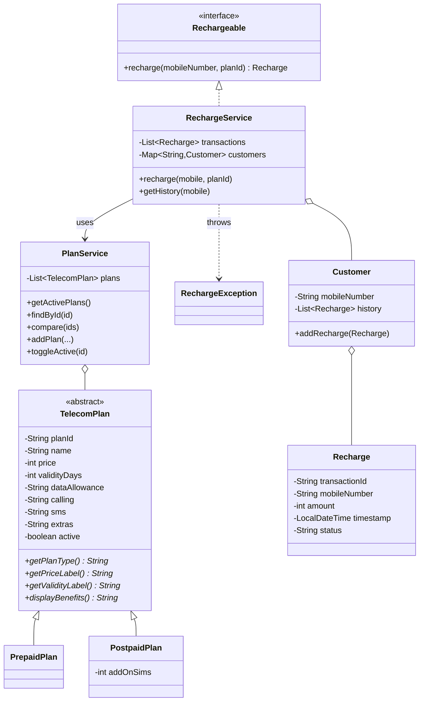
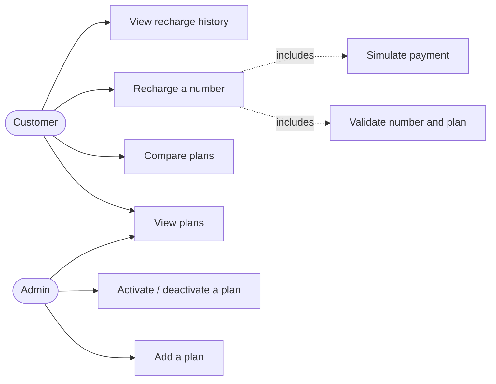

# TeleConnect – Project Report Notes

## 1. UML class diagram

## 2. Use-case diagram

## 3. Class notes
| Class | Role |
|---|---|
| `TelecomPlan` | Abstract parent. Holds shared data (ID, name, price, validity, data, calls, SMS, extras, active flag) and validates it in the constructor. |
| `PrepaidPlan` | Plan paid up front for a fixed number of days. Overrides the four abstract methods. |
| `PostpaidPlan` | Monthly-bill plan (30-day cycle) with an extra `addOnSims` field. |
| `Rechargeable` | Interface with one method, `recharge(mobile, planId)`. |
| `RechargeException` | Checked exception for expected problems (bad number, unknown plan, failed payment). |
| `Recharge` | One transaction. Copies plan name, type and price so history stays correct later. |
| `Customer` | A mobile number plus its list of `Recharge` objects. |
| `PlanService` | Owns the plan list; seeds six sample plans; lists, finds, compares, adds, toggles. |
| `RechargeService` | Implements `Rechargeable`: validate → simulate payment → record. Stores transactions and customers. |
| `HomeController`, `PlanController`, `RechargeController` | Receive browser requests, call services, pick a Thymeleaf template. No business logic. |
| `TeleConnectApplication` | Starts Spring Boot. |

## 4. Design decisions (plain language)
- **Why an abstract class?** Every plan shares data and rules, but "Plan" alone is never sold, only Prepaid or Postpaid.
- **Why one `List<TelecomPlan>`?** Showing that a parent reference can hold either child is the point of polymorphism.
- **Why redirect after recharge?** Refreshing the receipt page then cannot submit a second recharge.
- **Why validate in Java and not JavaScript?** Browser checks can be bypassed; `script.js` only adds convenience.
- **Why no record on failure?** `RechargeService` creates and stores the `Recharge` only after validation and payment both succeed.

## 5. Demo script (about 5 minutes)
1. Run `mvn spring-boot:run`; open `http://localhost:8080`. Say: "Data is in `ArrayList`s and resets on restart."
2. **Plans:** show the cards. Point out that prepaid shows "₹199 one-time" and postpaid "₹399 / month" – same method call, different class (polymorphism).
3. **Compare:** tick Everyday 199 and Postpaid Lite → *Compare selected*.
4. **Bad input:** recharge with `12345` → error from Java.
5. **Failure:** valid number with *Simulate a failed payment* → error; open History for that number → "No recharges found".
6. **Success:** recharge `9876543210` with Everyday 299 → receipt → History.
7. **Admin:** add a plan, then deactivate it and show it vanishes from Plans.
8. Open `TelecomPlan.java`, `PrepaidPlan.java`, `RechargeService.java` and `mvn test` to close.

## 6. Viva questions and answers
**Q1. What is encapsulation here?** Fields such as `price` are `private`; other classes use getters. `Customer.getHistory()` returns an unmodifiable list so history can only change through `addRecharge`.

**Q2. Why is `TelecomPlan` abstract?** It defines what every plan must provide (`getPriceLabel()`, `displayBenefits()` …) without being a sellable plan itself. You cannot write `new TelecomPlan(...)`.

**Q3. Where is inheritance used?** `PrepaidPlan` and `PostpaidPlan` extend `TelecomPlan` and reuse its fields, constructor validation and getters.

**Q4. Show polymorphism.** `PlanService` stores `List<TelecomPlan>`. Calling `plan.getPriceLabel()` runs the Prepaid or Postpaid version at runtime depending on the actual object (runtime/dynamic polymorphism via overriding).

**Q5. Abstract class vs interface?** An abstract class shares state and code between related classes ("is a plan"). An interface is a contract of ability ("can recharge") that unrelated classes can implement. A class can implement many interfaces but extend only one class.

**Q6. Why have `Rechargeable` at all?** It separates *what* a recharge does from *how*. A future `RealGatewayRechargeService` could implement it without changing controllers' idea of recharging.

**Q7. Composition vs inheritance?** Composition is "has-a": `Customer` has `Recharge`s, `RechargeService` has a `PlanService`. Inheritance is "is-a": `PrepaidPlan` is a `TelecomPlan`.

**Q8. How are exceptions handled?** Expected problems throw `RechargeException` (checked, so callers must handle it). The controller catches it and redisplays the form with the message. Invalid plan data throws `IllegalArgumentException`.

**Q9. Overloading vs overriding in this project?** Overriding: subclasses redefine `getPlanType()`. Overloading: `RechargeService.recharge(mobile, planId)` and `recharge(mobile, planId, simulateFailure)`.

**Q10. Which collections and why?** `ArrayList` keeps plans/transactions in order; `HashMap<String, Customer>` finds a customer by mobile number quickly.

**Q11. What happens on restart?** All plans added by admin and all transactions are lost, because they exist only in memory.

**Q12. What does `final` do on fields?** `planId`, `price` etc. cannot be reassigned after construction, so plan data is immutable except the `active` flag.

**Q13. How do you avoid duplicate transactions?** POST then redirect to a receipt URL (GET), and `RechargeService.recharge` is `synchronized` with a counter in each transaction ID.

**Q14. How would you add a "Corporate" plan type?** Create `CorporatePlan extends TelecomPlan`, implement the four abstract methods and add a case in `PlanService.createPlan`. Templates need no change.
